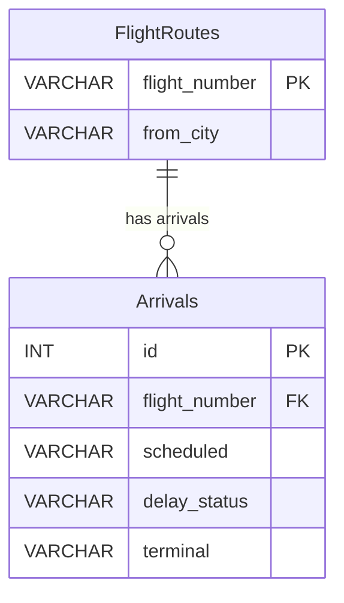

# JDBC Flight Manager — Exercise 3

## 1. Project Description

This project was developed as part of the Software Engineering Methods course at Braude College of Engineering.

The system manages airport flight arrivals using Java, JDBC, and a MySQL relational database.

The project includes:
- Importing 299 flight records from a CSV file.
- Normalizing the database into Third Normal Form (3NF).
- Displaying flight arrivals by terminal.
- Updating flight statuses using JDBC.
- Performing batch updates with PreparedStatement.
- Demonstrating and preventing SQL Injection attacks.

## 2. Engineering Team Details

Course: Software Engineering Methods  
Institution: Braude College of Engineering

Student A: [Michael lucia]  
Student B: [Meytar yehoshua]

Development Method: Driver–Navigator Pair Programming

Both students collaborated on database setup, testing, security analysis, and documentation.

Student A developed SimpleFlightUpdater.

Student B developed AdvancedFlightDispatcher.

## 3. Technology Stack

- Java — BellSoft Liberica JDK 25
- IntelliJ IDEA Ultimate
- MySQL Server 8.0.46
- MySQL Connector/J 9.5.0
- JDBC
- Git and GitHub
- LM Studio
- Qwen2.5-Coder-7B-Instruct
- Continue AI Assistant

## 4. Database Normalization (3NF)

Initially, the database contained one table:

rawflights(scheduled, flight, fromC, delay, terminal)

The functional dependency was:

flight → fromC

Each flight number determines its departure city.

Storing departure cities repeatedly in the raw table introduces data redundancy and may cause update, insertion, and deletion anomalies.

To improve the database structure, we normalized it into two tables:

### FlightRoutes

- flight_number — VARCHAR(50), Primary Key
- from_city — VARCHAR(100), NOT NULL

### Arrivals

- id — INT, Auto Increment, Primary Key
- flight_number — VARCHAR(50), Foreign Key
- scheduled — VARCHAR(50)
- delay_status — VARCHAR(50)
- terminal — VARCHAR(10)

The relationship uses:

FOREIGN KEY (flight_number)
REFERENCES FlightRoutes(flight_number)
ON DELETE CASCADE

The normalized database contains 299 arrival records.

Normalization reduces duplicated route information and helps maintain data consistency.

## 5. Independent AI Prompt — FlightViewer.java

The following prompt was written and submitted to Continue:

Write a complete Java class named FlightViewer with a main method for an airport arrivals system.

Connect to the MySQL database FlightDB at localhost:3306 using the JDBC URL jdbc:mysql://localhost:3306/FlightDB?allowLoadLocalInfile=true&allowPublicKeyRetrieval=true&serverTimezone=Asia/Jerusalem&useSSL=false and user root. Ask for the root password with a Scanner on System.in. Use try-with-resources for the Connection, the PreparedStatement, and the ResultSet.

Ask the user to enter a terminal number. The valid terminals are 2, 3, 4, and 5. If the input is not one of these, print an error message and ask again.

Run a SELECT query that joins the Arrivals table with the FlightRoutes table using an INNER JOIN on flight_number. Select Arrivals.scheduled, Arrivals.flight_number, FlightRoutes.from_city, and Arrivals.delay_status. Filter with WHERE Arrivals.terminal = ? and sort with ORDER BY Arrivals.scheduled ASC. Use a PreparedStatement with a ? placeholder. Bind the terminal value with pstmt.setString(1, terminal). Do not concatenate user input into the SQL string.

Print the results as a formatted table with column headers, one flight per line. If no rows match, print a clear message saying there are no arrivals for that terminal.

Add Javadoc to the class and to the main method, explaining the purpose of the class and why a PreparedStatement is used.

## 6. Entity Relationship Diagram (ERD)



The FlightRoutes table is connected to Arrivals through flight_number.

Each arrival references one flight route, while a flight route can be associated with multiple arrival records.

## 7. Security Audit Summary

### Original Vulnerability

The original SimpleFlightUpdater used a standard Statement and concatenated user input directly into an SQL query.

This made the application vulnerable to SQL Injection.

### SQL Injection Demonstration

The following input was used:

`Landed' #`

The resulting SQL command ignored the WHERE condition because the # character started a MySQL comment.

As a result, all 299 arrival records were updated instead of just one.

### Security Refactoring

The vulnerable Statement was replaced with a PreparedStatement using parameterized queries.

The updated implementation uses:

```java
String sql = "UPDATE Arrivals SET delay_status = ? WHERE flight_number = ?";

preparedStatement.setString(1, userInput);
preparedStatement.setString(2, "LX354");
```

### Verification Results

Before refactoring:
- 299 rows were affected.

After refactoring:
- Only 1 row was affected.
- The input was treated as literal text.
- The remaining 298 rows were not modified by the secure update.

PreparedStatement separates SQL syntax from user data and prevents the demonstrated SQL Injection vulnerability.

## 8. License

This project was developed for educational purposes as part of the Software Engineering Methods course at Braude College of Engineering.

No separate software license has been assigned.
